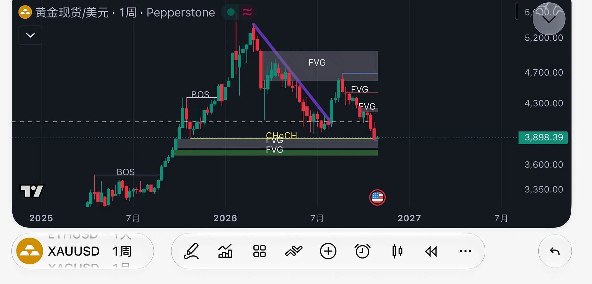

# 黄金周线案例：BOS、CHoCH 与 FVG 怎么一起看

> 整理日期：2026 年 11 月 3 日。图由用户提供，具体截图时刻未知；未独立验证行情真实性、是否回放或最后一根周 K 是否收盘。本文是截图阅读练习，不是实时黄金走势判断或交易指令。

[分析方法指南](market_structure_analysis_guide.md) · [术语速查](technical_analysis_glossary.md) · [目录](README.md)

原图保留全部用户标注，未重画；文件名日期是整理日期。图中标题为“黄金现货/美元 · 1周 · Pepperstone”，底部标识 XAUUSD，报价标签为 **3,898.39**。图上有延伸到 2027 年的空白时间轴，不能据此把最后一根 K 线认定为 2027 年行情。

## 一、先给一个有边界的判断

**按图可见结构，更像周线下跌后正在测试较大级别支撑；尚不能确认止跌反转。** 这个判断来自前高之后的更低反弹高点，以及右侧再次回到原低位区域，而不是因为图上写了 FVG 或 CHoCH。

| 证据类别 | 本图能说到什么程度 |
|---|---|
| 可直接观察 | 周线；图示报价源；3,898.39 标签；左侧上涨、冲高回落、越过紫线后反弹再下跌；作者画了多处区域 |
| 根据图形作出的解释 | 中期结构偏弱，下方旧区域正在接受测试；上方前次反弹区域可能构成阻力 |
| 目测估读 | 黄色线、灰框、绿框和上方阻力的大致价格范围，不能作为精确订单价格 |
| 无法确认 | 精确 OHLC、截图时间、是否回放、周线收盘状态、每个框对应哪三根 K 线、标注算法与后续结果 |
| 图中没有的证据 | 成交量、RSI、MACD、订单簿、机构持仓；不能写成放量、超卖、底背离或机构吸筹已确认 |

## 二、从左到右拆解

### 1. 左侧上涨：BOS 描述结构延续

价格从约 3,300 一带逐步走高，图上两处 BOS 标注位于此前高点附近，作者用它们表达向上突破。更完整的验证需要确认当时参考的是哪个波段高点、是否以收盘越过为准；本图能看出上涨序列，但不能重建全部精确规则。

### 2. 高位回落：重要的是高低点序列

价格到达 5,200 上方后出现明显回落，随后的反弹未回到此前高位。紫色下降趋势线连接并描述一段下行压力，它不是决定价格方向的原因，选取不同端点会改变突破时间。

### 3. 越过紫线：先发生反弹，未证明周线反转

价格曾突破紫线，反弹到约 4,600～4,700，进入上方大灰框的下沿附近；随后回落，再次到达旧低位区域。这一段说明“突破趋势线”和“建立持续上涨结构”不是同一个确认条件。

要判断结构改善，需要进一步看能否越过重要反弹高点、回踩后保持更高低点。仅凭穿过一条斜线，无法推断此前高点必然被突破。

### 4. 当前区域：触及支撑与确认 CHoCH 要分开

右端价格接近黄色线及下方灰框。作者把黄色线标为 CHoCH，可能在观察此前大级别上涨的重要低点是否失守。但没有原始读数和周收盘状态，**目前只能把它当作待核验的结构边界**。

即使较大结构后来确认向下 CHoCH，也只是该结构原先上涨假设受到破坏；在较小的已下降结构中，同一次下破可能被叫作向下 BOS。标签差异不应掩盖实际参考点与确认周期。

## 三、关键区域清单

以下按截图纵轴估读，通常按 XAUUSD 的美元／金衡盎司口径理解，但具体产品合约条款未核对。区间取整、可能重叠，不是原图精确边界。

| 大致区域 | 图中位置 | 分析用途 |
|---|---|---|
| 约 3,800～3,900 | 黄色线与下方灰框附近 | 当前第一层支撑观察区，关注周收盘能否收回结构边界 |
| 约 3,700～3,800 | 更下方绿色框附近 | 第一层失守后的下一观察区，不能预设必然守住 |
| 约 4,100～4,250 | 白色虚线和最近的小 FVG 附近 | 反弹初期需处理的阻力区域 |
| 约 4,400～4,450 | 中间红色 FVG 标记附近 | 检查反弹是否仍形成更低高点 |
| 约 4,600～5,000 | 上方大灰框 | 较大阻力候选区，约 4,700 的前次反弹高点尤其值得复核 |

“前低、FVG、绿色框都在附近”不一定是三份独立证据：它们可能源自同一段价格移动。原图没有标明绿色框的构造方式，不能擅自认定为已验证订单块或真实机构需求。

## 四、后续三种情境，不提前选择答案

| 情境 | 需要新增的观察 | 接下来检查 | 什么会削弱该情境 |
|---|---|---|---|
| 支撑有效，逐步修复 | 在下方区域止跌，周线收回黄色边界；进一步收复约 4,100～4,250 并形成更高低点 | 约 4,400～4,450 及前次约 4,700 高点附近 | 收复失败，再破修复过程中的低点 |
| 支撑失守，延续下跌 | 周线明确落到所选边界下方，反抽又无法收回 | 下方灰框、绿框的精确边界及后续反应 | 重新收回区域并保持在其上，形成新的结构 |
| 支撑附近横盘 | 既没有持续破低，也突破不了近端阻力，高低点重叠 | 固定区间边界，等待满足规则的突破 | 区间被有效突破并出现延续 |

“有效”需要在观察前定义，例如采用哪一根周线收盘、是否需要后续回踩，以及如何处理短暂影线越界。本表没有给出胜率，也没有验证任何区域会守住。

**末端一根小 K 线不能单独证明周线见底；阳阴还需核对开收盘价，不能仅凭可配置的颜色判断。** 即使出现日线看涨 CHoCH，也可能只是周线下跌中的反弹；本截图没有日线，不能补造该信号。

## 五、如果拿到原始图表，按这个顺序复核

1. 确认合约、数据源、时区、截图时刻和最后一根是否完成；把行情时间与分析时间分开。
2. 读取黄色线对应前低、最近反弹高点和各框的精确上下沿，不把截图像素估读作为订单依据。
3. 给每个 FVG 标出 A/B/C 三根 K 线时间，按[方法指南](market_structure_analysis_guide.md)核对影线是否有间隔、是否已被回访或穿越。
4. 固定主要摆动与内部摆动的规则，检查 CHoCH/BOS 是否使用同一尺度。
5. 若需要多周期观察，再读取同一时点已知的日线；需要量价验证时，核实成交量字段含义及覆盖范围。
6. 按事先情境记录后续结果，包括错误判断和未触发情况，不能看到后来上涨才把当前图改称“完美底部”。

## 六、练习与参考答案

1. 上穿紫线后为何不能直接判定上涨趋势恢复？
2. 黄色线附近写了 CHoCH，是否就说明已完成周线向下确认？
3. 下方 FVG 与绿色区域叠在一起，是否能算出很高的反弹概率？
4. 仅凭这张图，能否写“黄金缩量下跌、RSI 超卖”？

答案：① 还需检查重要高点、回踩低点与延续；② 不能，需核对参考低点、精确价格及周收盘；③ 不能，缺少独立样本与固定规则，区域还可能来自同一走势；④ 不能，图中没有这些数据。

术语与流程依据见[方法指南中的来源链接](market_structure_analysis_guide.md)。本例的图形观察来自用户截图，未引用或生成额外市场行情。
