# 投资策略与流派梳理

> 整理日期：2026 年 7 月 30 日。本文用于建立投资方法框架，不构成个性化投资建议或收益承诺。实际投资前应结合资金期限、风险承受能力、税费、交易成本和产品合同条款独立判断。

## 一句话总览

投资策略本质上是在回答一个问题：**你想赚哪一种钱**。

不同流派并不是互相排斥的答案，而是对收益来源、风险来源和执行方式的不同选择。普通投资者通常更适合用“宽基指数或资产配置做核心，少量风格、行业、主题或交易策略做卫星”的方式组合使用。

## 主流投资策略流派

| 流派 | 想赚的钱 | 核心逻辑 | 典型工具 | 主要风险 |
|---|---|---|---|---|
| 被动指数派 | 市场长期上涨的钱 | 不预测个股和择时，持有宽基市场组合 | 宽基指数基金、ETF | 市场整体下跌、长期横盘、估值过高 |
| 资产配置派 | 大类资产风险溢价的钱 | 在股票、债券、现金、黄金、商品等资产间分散和再平衡 | 股债组合、全天候、目标日期基金 | 配置假设失效、相关性上升 |
| 价值投资派 | 低估修复的钱 | 买入价格低于内在价值的资产，等待市场重新定价 | 低 PE/PB、高股息、困境反转 | 价值陷阱、基本面继续恶化 |
| 成长投资派 | 企业高速增长的钱 | 为未来收入、利润和市场空间支付较高估值 | 科技成长、医药创新、消费成长 | 增长不达预期、估值压缩 |
| 质量/护城河派 | 优秀企业长期复利的钱 | 买竞争优势强、现金流好、管理层优秀的公司 | 高 ROE、强品牌、网络效应、成本优势公司 | 买得太贵、护城河被削弱 |
| 股息/现金流派 | 分红、利息和租金的钱 | 重视稳定现金回报和持有期收入 | 红利 ETF、债券、REITs、公用事业股 | 分红下降、利率上行、资产质量变差 |
| 趋势/动量派 | 趋势延续的钱 | 价格强势往往会持续一段时间，顺势而为 | 均线、突破、相对强弱、行业轮动 | 震荡市反复止损、追高回撤 |
| 宏观/周期派 | 经济和政策周期切换的钱 | 根据增长、通胀、利率、汇率和政策变化配置资产 | 股票、债券、商品、黄金、外汇 | 宏观判断对但节奏错 |
| 量化/因子派 | 统计规律和风格溢价的钱 | 用系统规则捕捉长期有效的因子 | 价值、动量、质量、低波动、小市值、Carry | 因子拥挤、交易成本、历史规律失效 |
| 事件驱动派 | 特殊事件重估的钱 | 围绕并购、重组、回购、分拆、指数纳入等事件定价 | 并购套利、重组股、定增、指数调整交易 | 事件失败、审批变化、时间拉长 |
| 套利/相对价值派 | 价差收敛的钱 | 买低估的一边，卖高估的一边，等待价差回归 | 可转债套利、ETF 折溢价、期现套利、配对交易 | 杠杆、流动性、制度变化 |
| 专业投机/技术交易派 | 价格波动和赔率的钱 | 不执着预测价值，重视趋势、止损、仓位和风险回报 | 1-2-3 反转、2B 假突破、波段交易、趋势跟随 | 纪律失效、过度交易、连续亏损 |

## 各流派展开

### 1. 被动指数派

被动指数派认为，多数投资者很难长期稳定战胜市场，因此应以低成本方式持有市场组合。它的关键不是“买哪个神奇指数”，而是长期持有、控制费用、分散风险，并在市场大幅波动时不轻易放弃计划。

常见做法：

- 买入宽基股票指数基金或 ETF。
- 使用股票、债券和现金的基础组合。
- 定期定额投入，减少一次性择时压力。
- 按年度或阈值再平衡。

适合人群：长期资金、没有时间研究个股、希望降低决策复杂度的投资者。

### 2. 资产配置派

资产配置派关注的不是单只股票，而是不同资产类别在不同环境下的表现差异。它认为长期收益和回撤很大程度上来自资产比例，而不是个别标的选择。

常见做法：

- 股票提供长期增长弹性。
- 债券提供利息和风险缓冲。
- 现金提供流动性和再投入能力。
- 黄金或商品对冲部分通胀、汇率或信用风险。
- 定期再平衡，把涨多的资产减一点，跌多但逻辑未变的资产补一点。

核心难点：资产之间的相关性并不是固定的，危机时可能一起下跌。

### 3. 价值投资派

价值投资派的核心是“以低于价值的价格买入”。低估可能来自市场悲观、行业周期低谷、短期坏消息或流动性折价。

常见分支：

- 深度价值：买极度便宜的资产，关注清算价值或资产重估。
- 低估修复：买估值明显低于历史或同业的公司。
- 困境反转：买暂时遇到困难但有修复可能的公司。
- 价值成长：在合理价格买入仍能增长的公司。

最大风险：低估可能不是误判，而是基本面真的变差。

### 4. 成长投资派

成长投资派重视未来收入、利润、用户规模、市场空间和商业模式扩张能力。它愿意为未来支付溢价。

常见场景：

- 新技术渗透率提升。
- 行业集中度提高。
- 产品从小众走向大众。
- 公司从单一产品扩展到平台生态。

关键问题：

- 增长是否真实可持续？
- 毛利率、现金流和竞争格局是否支持估值？
- 高增长是否已经被股价充分定价？

### 5. 质量/护城河派

质量派不只问“便不便宜”，更问“这是不是一门长期好生意”。它重视商业模式、竞争优势、资本回报率、现金流质量和管理层能力。

常见护城河：

- 品牌和心智。
- 网络效应。
- 成本优势。
- 规模优势。
- 渠道和客户粘性。
- 专利、牌照或监管壁垒。

主要风险：好公司如果买得太贵，也可能长期收益一般。

### 6. 股息/现金流派

股息派追求可见现金流，尤其适合重视稳定收入的资金。它不等同于简单追逐最高股息率，而是要看分红是否可持续。

重点指标：

- 分红率是否合理。
- 自由现金流是否覆盖分红。
- 负债和资本开支是否可控。
- 行业是否稳定。
- 历史分红是否连续。

主要风险：股息率高有时是股价大跌后的结果，背后可能是利润下滑或资产质量恶化。

### 7. 趋势/动量派

趋势派相信价格走势包含信息，强势资产可能继续强势，弱势资产可能继续弱势。它更关注“市场正在做什么”，而不是“我认为它应该怎样”。

常见方法：

- 均线趋势。
- 突破交易。
- 相对强弱排序。
- 行业轮动。
- 中长期趋势跟随。

执行关键：

- 明确入场信号。
- 明确止损规则。
- 避免在震荡市频繁交易。
- 接受小亏损，用少数大趋势覆盖多次试错。

### 8. 宏观/周期派

宏观派从经济增长、通胀、利率、汇率、信用周期和政策方向出发，判断哪些资产更占优。

常见思路：

- 复苏期：股票和顺周期资产可能更强。
- 过热期：商品和资源品可能更受益。
- 滞胀期：现金流、防御资产、部分商品可能更重要。
- 衰退期：高等级债券和防御资产可能更有吸引力。

核心难点：宏观判断即使方向正确，资产价格也可能提前反映，导致入场节奏很难。

### 9. 量化/因子派

量化因子派把投资规则系统化，用数据筛选和组合构建来捕捉风格溢价。它强调可回测、可重复、可纪律化。

常见因子：

- 价值：便宜资产相对昂贵资产的超额收益。
- 动量：近期强势资产继续强势。
- 质量：盈利稳定、现金流好、财务稳健。
- 低波动：波动较低资产可能有更好的风险调整收益。
- 小市值：小公司长期可能存在规模溢价。
- Carry：持有高收益资产、融资低收益资产的利差收益。

主要风险：历史规律不一定持续，交易成本、拥挤交易和模型过拟合会削弱收益。

### 10. 事件驱动派

事件驱动派围绕明确事件进行投资，关注事件前后资产价格如何重新定价。

常见事件：

- 并购和私有化。
- 重组和资产注入。
- 回购和特别分红。
- 分拆上市。
- 指数纳入或剔除。
- 破产重整。
- 定增和股权激励。

主要风险：事件失败、审批延迟、条款变化和资金占用时间过长。

### 11. 套利/相对价值派

套利派不一定判断资产绝对涨跌，而是判断两个相关价格之间的偏离是否会收敛。

常见策略：

- ETF 折溢价套利。
- 期现套利。
- 可转债套利。
- 分级或衍生品结构套利。
- 配对交易。

需要特别注意：很多套利看似低风险，实际风险来自杠杆、流动性突然消失、交易规则变化和极端行情。

### 12. 专业投机/技术交易派

专业投机派强调市场行为、趋势、止损、仓位和赔率。它不把“预测正确”放在第一位，而是把“错了亏小、对了赚大”放在第一位。

核心原则：

- 先活下来，避免毁灭性亏损。
- 趋势比观点重要。
- 用证据确认反转，不凭感觉猜顶猜底。
- 每笔交易先定义止损，再考虑收益。
- 小亏可控，大赚放行。

常见技术框架：

- 1-2-3 反转：趋势线被破坏、不再创新高或新低、突破关键回调点。
- 2B 假突破：价格突破前高或前低后快速回到区间内，显示突破失败。
- 趋势跟随：顺着已经形成的趋势持有，直到趋势证伪。

## 各流派关注指标与交易决策

建仓、加仓、止盈、止损不是所有流派都用同一套语言。长期投资类策略更重视“估值、基本面和配置比例是否还成立”，不宜把短期价格波动机械等同于止损信号；交易类策略则必须提前定义价格止损、仓位上限和单笔亏损上限。

通用原则：

- 建仓前先写清楚：买入理由、目标仓位、最大可承受亏损、退出条件。
- 加仓只能发生在证据变强或价格更有吸引力时，不能只是因为已经亏损。
- 止盈不是“赚了就卖”，而是当赔率下降、仓位超限、估值过高或趋势证伪时降低风险。
- 止损分两类：投资型止损看逻辑失效，交易型止损看价格触发。
- 不同流派可以组合使用，但同一笔交易的进出规则必须保持一致。

| 流派 | 重点关注指标 | 建仓决策 | 加仓决策 | 止盈决策 | 止损/退出决策 |
|---|---|---|---|---|---|
| 被动指数派 | 指数覆盖范围、估值分位、费用率、跟踪误差、基金规模、流动性、股债比例、最大回撤 | 选择低费率、跟踪稳定、流动性充足的宽基产品；用定投或分批方式降低择时压力 | 按固定周期定投；或在指数回撤、估值分位下降、目标资产权重低于计划时补回 | 不按短期盈利止盈；当权益仓位超过目标上限、估值极端偏高或资金期限缩短时再平衡 | 通常不做短线价格止损；退出条件是投资期限变化、风险承受能力下降、基金跟踪失真、费用或流动性明显恶化 |
| 资产配置派 | 目标权重、资产估值、债券收益率、通胀、利率、相关性、波动率、组合回撤、现金需求 | 先确定股票、债券、现金、黄金等目标比例，再按风险预算分批建仓 | 当某类资产低于目标权重，或估值和收益率明显改善时再平衡加仓 | 某类资产涨到明显超配、估值过高或组合风险超过预算时减仓 | 当人生阶段、资金期限或风险承受能力变化时重设配置；不是因为单一资产短跌就全盘退出 |
| 价值投资派 | PE/PB/EV/EBITDA、自由现金流收益率、资产负债率、ROE、分红、净现金、行业周期、折价幅度 | 估算保守内在价值，只有价格相对价值有足够安全边际时分批买入 | 基本面未恶化且价格进一步低估，或经营拐点被验证时加仓 | 价格接近或超过合理价值、折价修复完成、出现更高赔率机会时卖出或换仓 | 原估值假设被证伪、现金流恶化、债务风险上升、管理层失信、行业永久性衰退时退出 |
| 成长投资派 | 收入增速、利润增速、毛利率、留存率、用户增长、单位经济模型、市场空间、研发效率、估值/增长匹配 | 在增长确定性较高、商业模式可验证、估值没有透支过多时分批建仓 | 增长数据继续兑现、利润率改善、竞争优势增强、回调后估值更合理时加仓 | 增速下台阶、估值显著透支、渗透率接近天花板或仓位过度集中时减仓 | 增长逻辑失败、客户流失、毛利率结构性下滑、竞争格局恶化、现金消耗失控时退出 |
| 质量/护城河派 | ROE/ROIC、自由现金流、毛利率稳定性、品牌力、客户粘性、市场份额、负债率、管理层资本配置 | 优质公司进入合理价格区间时建仓，不强求最低估值 | 护城河增强、业绩质量稳定、短期波动导致估值回到合理区间时加仓 | 估值极端高、预期收益率明显下降、单一持仓超出组合上限时减仓 | 护城河被削弱、资本回报率长期下滑、现金流质量变差、治理问题或主业竞争力恶化时退出 |
| 股息/现金流派 | 股息率、分红率、自由现金流覆盖倍数、债务期限、利息覆盖倍数、资本开支、派息历史、监管政策 | 股息率相对历史和债券收益有吸引力，且分红由真实现金流支撑时建仓 | 股价回落使现金回报更高，同时分红覆盖和资产质量未恶化时加仓 | 股息率被价格上涨压低、分红增长停滞、利率环境变化或仓位超配时减仓 | 分红被削减、自由现金流无法覆盖分红、负债再融资压力上升、主业现金流恶化时退出 |
| 趋势/动量派 | 均线斜率、价格新高/新低、相对强弱、成交量、波动率、行业强弱、回撤深度 | 价格突破关键区间、站上趋势均线、相对强度排名靠前时试仓 | 突破后回踩不破、趋势延续、波动率可控时金字塔加仓 | 趋势加速过热、相对强度下降、跌破短期趋势线或达到预设风险回报目标时分批止盈 | 跌破关键均线、前低、突破位或 ATR 止损线时执行；单笔亏损必须提前限定 |
| 宏观/周期派 | PMI、CPI/PPI、利率、收益率曲线、信用利差、汇率、财政政策、货币政策、库存周期、企业盈利周期 | 宏观阶段与资产表现逻辑匹配，且价格尚未充分反映时建仓 | 数据连续验证同一方向、政策继续支持、资产价格仍有赔率时加仓 | 周期进入下一阶段、政策边际转向、资产拥挤或估值已充分反映时减仓 | 核心宏观假设反向变化，或市场走势与宏观判断长期背离且损失超过风险预算时退出 |
| 量化/因子派 | 因子暴露、历史胜率、信息比率、最大回撤、换手率、交易成本、容量、行业和风格偏离 | 因子有经济解释、回测不过拟合、交易成本可承受、组合分散后建仓 | 按模型再平衡；当因子暴露不足或组合偏离目标权重时机械调整 | 因子信号衰减、仓位达到上限、组合风险或行业偏离过大时减仓 | 模型失效、实盘回撤超过历史压力测试、交易成本上升、数据质量问题或因子拥挤时停用或降仓 |
| 事件驱动派 | 事件条款、审批概率、时间表、价差、失败损失、对手方信用、监管态度、资金占用成本 | 事件真实、条款清晰、预期收益覆盖失败损失和时间成本时建仓 | 审批进展、股东投票、监管反馈等证据提高成功率，且价差仍有吸引力时加仓 | 价差大幅收敛、事件临近落地、收益率不再覆盖风险时退出 | 事件失败、条款变差、审批延迟超预期、对手方信用恶化或市场价格暗示失败概率上升时退出 |
| 套利/相对价值派 | 折溢价、基差、利差、相关性、回归速度、融资成本、保证金、流动性、交易规则 | 价差偏离超过历史区间和交易成本，并有明确收敛机制时建仓 | 价差继续扩大但机制未变、保证金和流动性充足时有限加仓 | 价差回归到目标区间、资金效率下降或风险收益不再划算时平仓 | 收敛机制失效、相关性断裂、保证金压力上升、交易规则变化、流动性枯竭时止损 |
| 专业投机/技术交易派 | 趋势结构、支撑阻力、1-2-3 反转、2B 假突破、成交量、ATR、胜率、盈亏比、仓位风险 | 出现明确交易信号，且潜在收益至少覆盖预设风险倍数时小仓试错 | 只有浮盈保护后才加仓；沿趋势用回踩、突破或移动止损递进加仓 | 达到目标位、趋势衰竭、出现反向信号或赔率下降时分批兑现 | 入场理由失效、跌破止损位、单笔亏损达到风险上限时立即退出，不摊平亏损 |

### 决策流程图

以下图示用于描述每个流派的典型决策顺序。它们不是固定公式，真实执行时还需要结合产品费率、税费、交易成本、流动性和个人风险预算。

#### 被动指数派

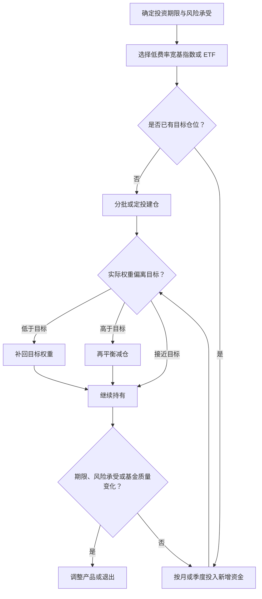

#### 资产配置派

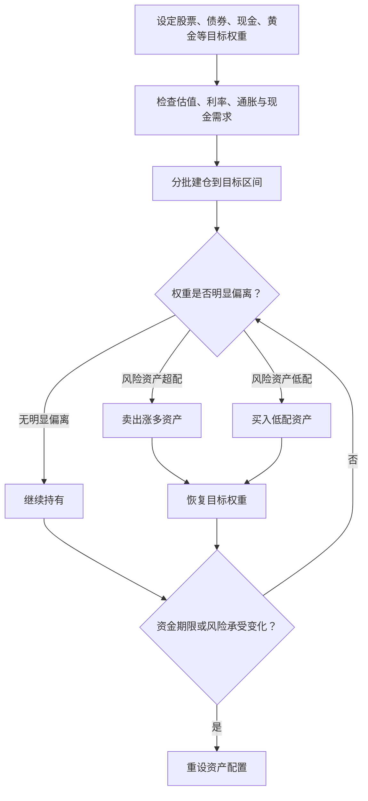

#### 价值投资派

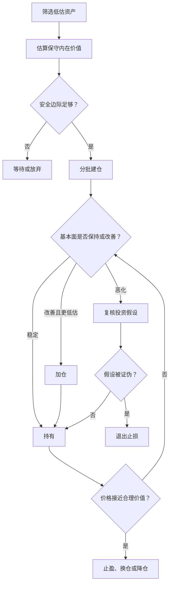

#### 成长投资派

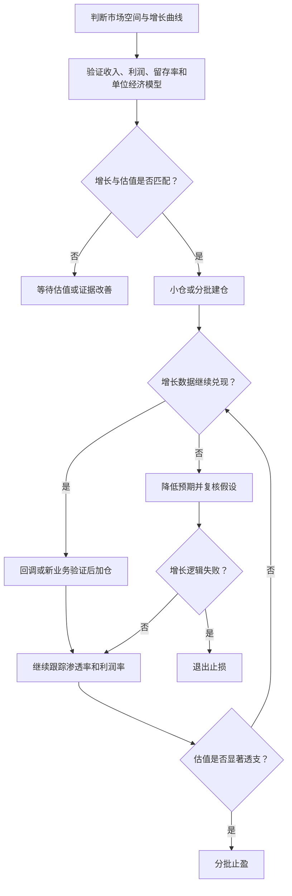

#### 质量/护城河派

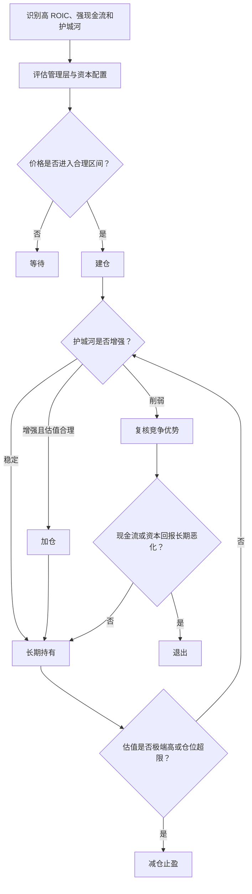

#### 股息/现金流派

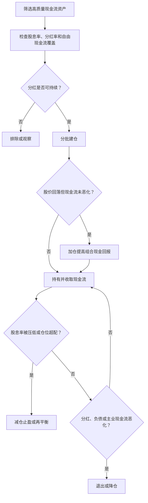

#### 趋势/动量派

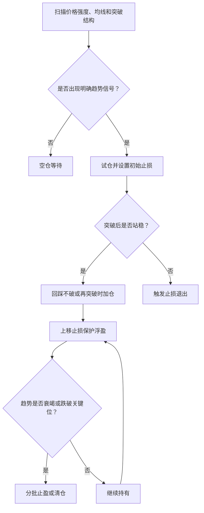

#### 宏观/周期派

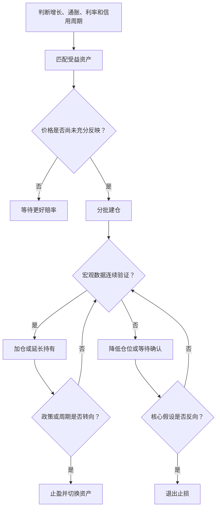

#### 量化/因子派

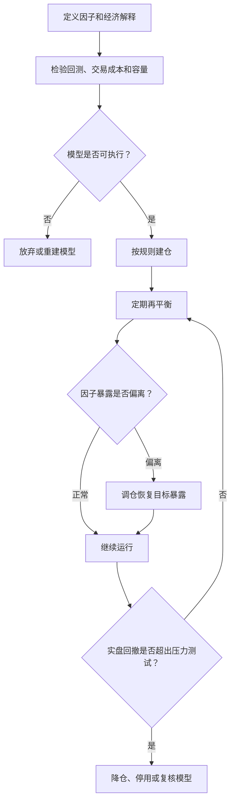

#### 事件驱动派

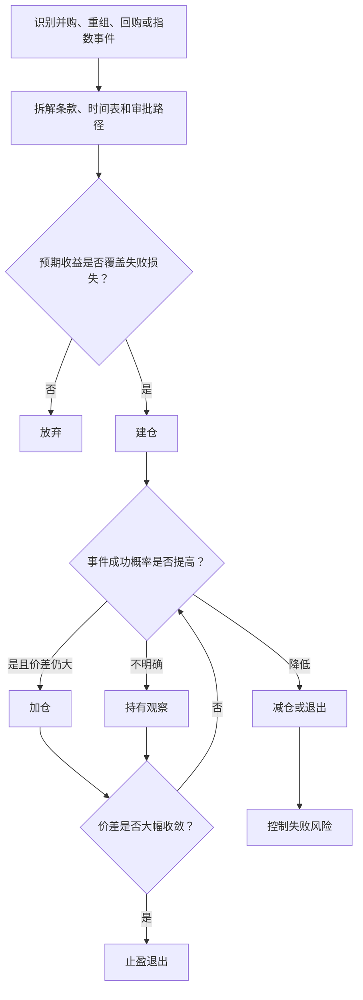

#### 套利/相对价值派

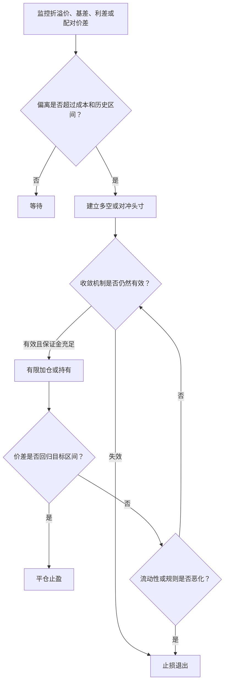

#### 专业投机/技术交易派

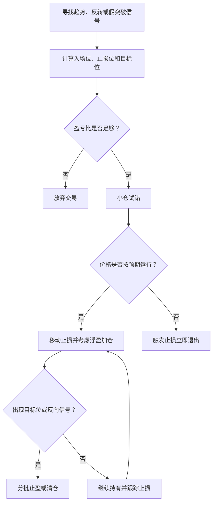

## 如何选择适合自己的流派

| 投资者情况 | 更适合的主框架 | 可选卫星 |
|---|---|---|
| 没时间研究、追求长期简单 | 被动指数派、资产配置派 | 红利、质量、少量主题 |
| 能阅读财报、愿意研究公司 | 价值投资派、质量/护城河派 | 成长、股息 |
| 能承受高波动、理解产业变化 | 成长投资派 | 质量、趋势、主题 ETF |
| 重视现金流和回撤控制 | 股息/现金流派、资产配置派 | 低波动、债券、REITs |
| 擅长规则执行和止损 | 趋势/动量派、专业投机派 | 量化因子、行业轮动 |
| 有数据和编程能力 | 量化/因子派 | 相对价值、趋势 |
| 能深度跟踪交易条款和事件 | 事件驱动派、套利派 | 价值、困境反转 |

## 一个实用组合框架

对多数普通投资者，可以把策略分为三层：

1. 核心层：宽基指数、股债配置、现金管理，承担长期基础收益。
2. 增强层：价值、质量、红利、成长或因子策略，承担风格增强收益。
3. 机会层：行业主题、事件驱动、趋势交易或专业投机，只用较小仓位承担高波动机会。

这个框架的重点不是追求每一层都赚钱，而是让不同策略在不同市场环境中互相补充。

## 常见误区

- 把策略名称当成收益保证。
- 用价值投资的理由买入，却用短线技术的情绪卖出。
- 用成长投资的估值买入，却没有持续跟踪增长兑现。
- 看到高股息就认为低风险。
- 把套利当成无风险。
- 因子回测很好看，但忽略真实交易成本和容量。
- 趋势交易没有止损，最后变成长期套牢。
- 宏观判断正确，却低估了市场提前反映和节奏错配。

## 参考来源

- Investor.gov, [Beginners' Guide to Asset Allocation, Diversification, and Rebalancing](https://www.investor.gov/additional-resources/general-resources/publications-research/info-sheets/beginners-guide-asset)
- Investor.gov, [Index Funds](https://www.investor.gov/introduction-investing/investing-basics/investment-products/mutual-funds-and-exchange-traded-4)
- Investor.gov, [Stocks - FAQs](https://www.investor.gov/introduction-investing/investing-basics/investment-products/stocks)
- Investor.gov, [Dollar Cost Averaging](https://www.investor.gov/introduction-investing/investing-basics/glossary/all)
- Investor.gov, [Types of Orders](https://www.investor.gov/introduction-investing/investing-basics/how-stock-markets-work/types-orders)
- FINRA, [Order Types](https://www.finra.org/investors/investing/investment-products/stocks/order-types)
- AQR Capital Management, [Understanding Style Premia](https://www.aqr.com/Insights/Research/Journal-Article/Understanding-Style-Premia)
