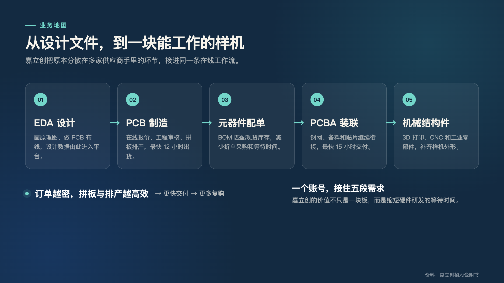
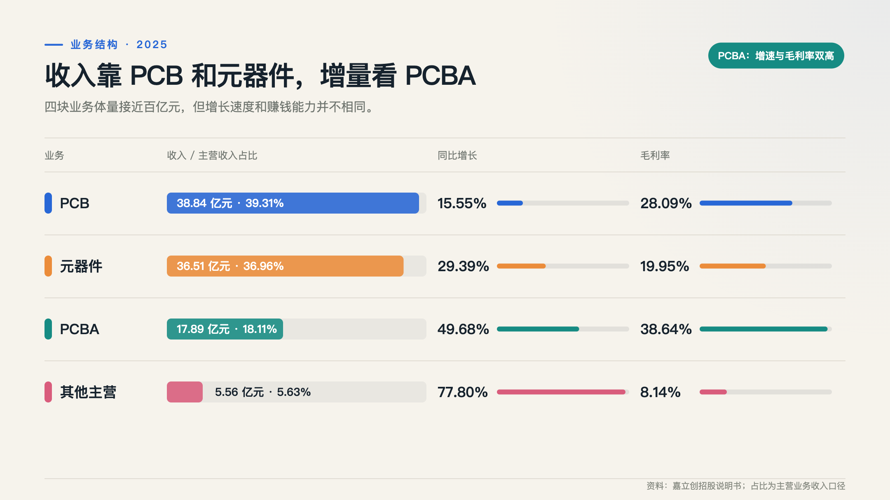
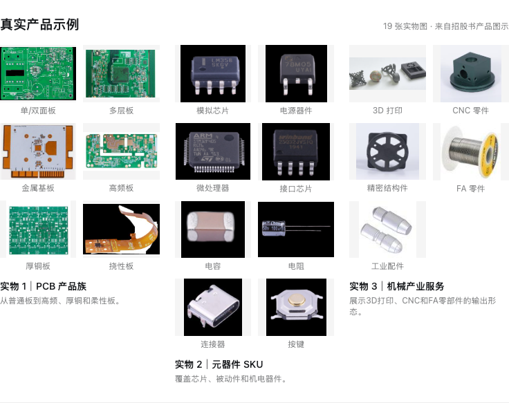
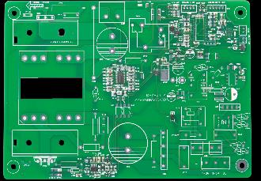
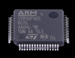
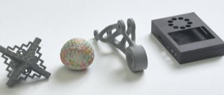
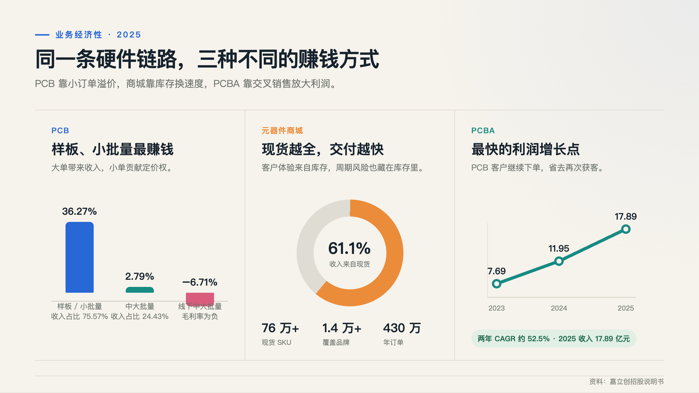
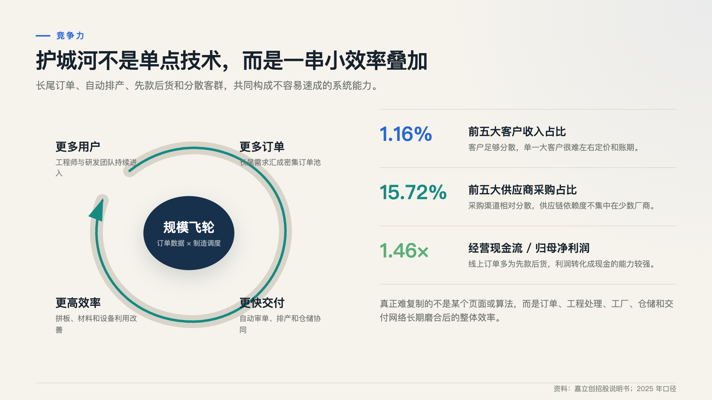
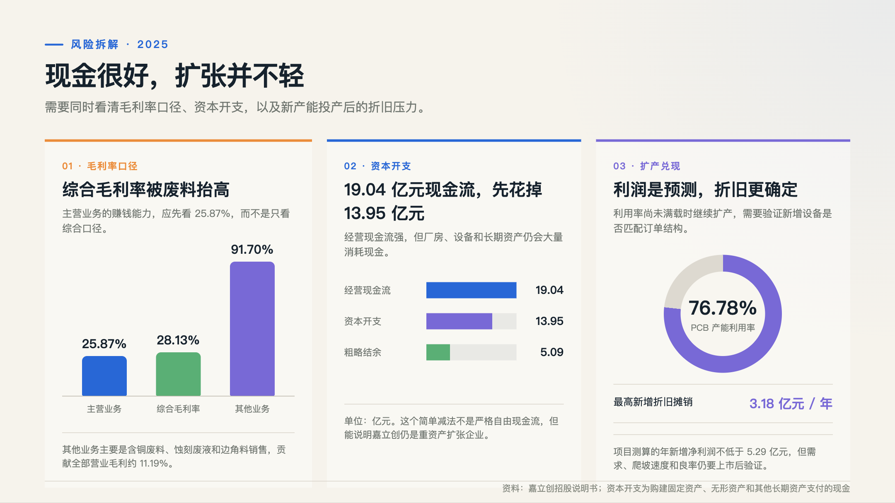
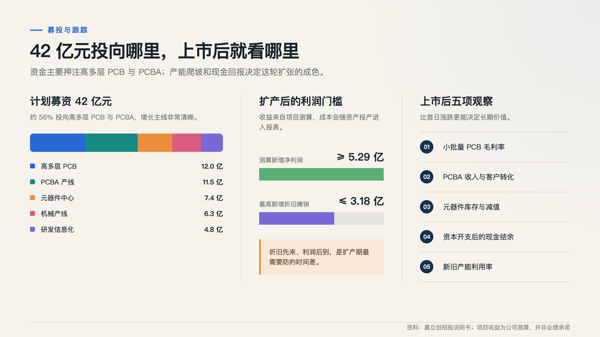

# 嘉立创打新值不值：从一块样板长出来的硬件生意

> 数据更新至 2026 年 7 月 27 日。本文依据嘉立创招股说明书、发行公告及网上申购公告整理，用于理解公司业务与发行风险，不构成收益保证或个性化投资建议。

做硬件的人，多半和嘉立创打过交道。

可能是晚上刚改完一版电路，把 Gerber 文件传上去，系统很快报出价格；也可能是拿着一张 BOM 找芯片、电阻和连接器，顺手把贴片一起下了单。以前要分别找几家供应商、来回确认工艺的事，现在一个账号就能办完大半。

嘉立创就是从这类琐碎、着急而且数量不大的需求里长出来的。它起家于 PCB 样板，如今已经把业务伸到 EDA 设计软件、元器件商城、PCBA 装联，以及 3D 打印和 CNC 加工。

所以，把嘉立创简单看成一家 PCB 厂，会漏掉它最值钱的部分；把它说成互联网平台，又容易低估工厂、库存和扩产带来的压力。它更像一套长在制造业里的硬件工作流。眼下的打新问题，其实是在判断：这套工作流值不值 38 倍市盈率，以及它能不能消化接下来的大规模投入。

我的看法先放在这里：通过正规券商参与这次打新有其合理性，已经中签的话，我会倾向正常缴款。但这不是“闭眼赚”的票。发行价留了一些相对估值空间，长期回报仍要看 PCBA 的增长能不能延续，以及 42 亿元募投项目投产后，利润能不能跑赢折旧。

## 从一块板，到一整条硬件工作流

截至 2025 年末，嘉立创在线网站累计注册用户约 959.16 万，年度付费用户约 135.73 万，全年处理订单约 2,108.18 万笔。单看这些数字只会觉得平台很大，放到它的生产方式里才更有意思。

嘉立创接到的订单往往面积小、批次少、规格杂，还催得急。这样的单子，传统大厂不一定愿意接；嘉立创把它们汇集起来，再用拼板和自动排产系统，把工艺相近的小订单塞进同一张大板生产。订单池越大，凑板越容易，设备和材料也用得更充分。

这套生意不是玄学。用户多，订单就密；订单密，交付和成本就更容易做好；体验稳定后，工程师下一次改板还会回来。更重要的是，同一个客户做完 PCB，往往还要买元器件、焊接板卡，甚至做外壳。嘉立创不用每次都重新获客，只要沿着样机开发过程继续往下接。

不过，它也不是那种赢家通吃的平台。工程师完全可以同时用别家的 EDA、在其他商城买料，再找另一家工厂贴片。嘉立创真正积累下来的，是订单数据、工程审核、生产调度、现货仓储和交付网络之间的配合。单独复制其中一环不算难，把整套流程磨顺却需要时间。

## 百亿收入背后，是四门脾气不同的生意

2025 年，嘉立创营业收入约 102.32 亿元，其中主营业务收入约 98.80 亿元。PCB 和元器件贡献了大部分收入，PCBA 的体量还没那么大，却是增长最快、毛利率最高的一块。

| 业务 | 2025 年收入 | 主营收入占比 | 同比增长 | 毛利率 |
|---|---:|---:|---:|---:|
| PCB | 38.84 亿元 | 39.31% | 15.55% | 28.09% |
| 电子元器件 | 36.51 亿元 | 36.96% | 29.39% | 19.95% |
| PCBA | 17.89 亿元 | 18.11% | 49.68% | 38.64% |
| 其他主营业务 | 5.56 亿元 | 5.63% | 77.80% | 8.14% |

这四块业务不能只按收入大小排序。PCB 是入口，也是制造底座；元器件商城用库存换交付速度；PCBA 把前两块业务串起来，赚到的毛利也更厚；机械业务增速很快，但目前更像刚开始复制经验的新战场。

招股书里的产品也很具体。PCB 包括单双面板、多层板、金属基板、高频板、厚铜板和挠性板；元器件既有数字、模拟芯片，也有被动和机电器件；机械业务则做 3D 打印、CNC 精密结构件和 FA 工业零部件。

| PCB | 数字芯片 | 3D 打印制品 |
|---|---|---|
|  |  |  |

这些实物放在一起，多少能解释嘉立创为什么很难被归进一个传统行业分类：它同时在做定制制造、现货分销和工程服务。上面的产品图片均来自嘉立创招股说明书。

## PCB 是起点，真正赚钱的是小订单

2025 年，嘉立创 PCB 业务出货接近 1,200 万单，付费用户超过 100 万，平均订单面积不到 1 平方米，最快 12 小时出货。数量很大，单子却普遍很小，这恰好是它的利润来源。

| PCB 订单类型 | PCB 收入占比 | 2025 年毛利率 |
|---|---:|---:|
| 样板、小批量 | 75.57% | 36.27% |
| 中大批量 | 24.43% | 2.79% |
| 其中：线下中大批量 | 9.04% | -6.71% |

小批量客户通常更在意省事和交期。为了几块样板多等一周，可能会拖慢整个研发进度，因此他们对单价没有大客户那么敏感。中大批量订单则完全是另一套游戏：采购方更强势，会反复压价，还要求稳定良率和持续供货。嘉立创保留这部分业务，一方面是陪客户从打样走到量产，另一方面也能填充产线；但从 2.79% 的毛利率看，它并不是眼前的利润支柱。

这也提醒我们，今后看 PCB 收入增长时，不能只看总数。如果增长主要来自低毛利的大单，收入会变漂亮，利润未必同步。样板和小批量的收入占比、毛利率，以及多层板和高频板等高附加值产品的变化，才更接近这块业务的真实成色。

## PCBA 是目前最顺的一步棋

PCB 做好以后还不能工作，芯片、电阻、电容得焊上去，才成为一块真正的电子模块。客户既然已经上传了板图，再交一份 BOM 和坐标文件，嘉立创就能接着完成配料、钢网和贴片。这次转化很自然，几乎没有重新教育客户的成本。

2025 年，PCBA 收入约 17.89 亿元，同比增长 49.68%，毛利率 38.64%；全年约 142 万单，最快 15 小时交付。2023 年到 2025 年，PCBA 收入从 7.69 亿元增至 17.89 亿元，两年复合增速约 52.5%，占主营收入的比重也从 11.80% 升至 18.11%。

它还会反过来给 PCB 和元器件带订单。仅 2025 年，PCBA 带动的 PCB 收入就约有 4.69 亿元，比上年多了约 1.51 亿元。嘉立创接下来能不能继续改善利润结构，很大程度上取决于有多少 PCB 用户愿意顺手把贴片也交给它。

元器件商城扮演的是另一种角色。截至 2025 年末，商城现货 SKU 超过 76 万，覆盖 1.4 万多个品牌，约有 750 家授权供应商，全年出货接近 430 万单，现货模式贡献了元器件业务收入的 61.1%。货放在自己仓里，客户才能快拿到，也更方便直接接入 PCBA。

代价是库存。2025 年末，公司存货账面价值约 9.11 亿元。型号淘汰、芯片价格下跌或者备货判断失误，都会变成滞销和减值。商城体验越依赖“有现货”，这笔风险就越难彻底甩掉。

至于 EDA，它更像前门，而不是收费站。到 2025 年末，嘉立创 EDA 累计注册用户超过 658 万，设计项目超过 5,200 万个，大部分功能免费。工程师在这里画图，随后可以直接下 PCB 订单，再接到元器件和 PCBA。这种获客方式比单纯投广告更贴近需求发生的地方。

机械业务则还在早期。3D 打印、CNC 和 FA 零部件商城 2025 年合计收入约 4.33 亿元，同比增长约 89.3%，但“其他主营业务”整体毛利率只有 8.14%。它证明了需求存在，离证明自己是一条成熟的第二增长曲线还有距离。

## 壁垒在流程里，现金也在流程里

嘉立创的客户很散。2025 年前五大客户收入占比只有 1.16%，前五大供应商采购占比约 15.72%。这让它不容易被单一大客户拿捏，也不必为了保住某几个订单接受过分苛刻的账期。

线上 PCB、元器件和 PCBA 又多采用先款后货。客户先付钱，公司再生产或发货，收入便更容易落成真金白银。订单足够多以后，拼板、采购、仓储和排产的效率还能继续摊薄成本。它的护城河没有某项惊人的黑科技，胜在一连串小效率叠加后，后来者很难在短时间里同时追上。

这里也正好解释三项最常见的财务指标。

2025 年营收 102.32 亿元，讲的是公司一年做了多大规模的生意。钱进了门，还要支付原料、人工、折旧、费用和税，所以营收高不等于股东赚得多。

归母净利润 13.06 亿元，是扣完这些成本和税费后，最终归属于母公司股东的会计利润。它比营收更接近“赚了多少”，但利润里可能包含尚未收回的应收款、折旧等非现金项目，因此也不能直接当作银行账户里的现金。

经营活动现金流净额 19.04 亿元，则是日常经营真正收进来的现金，减去采购、工资、税费等经营支出后的余额。它比净利润高出约 6 亿元，约为净利润的 1.46 倍，通常说明回款不错、利润的现金含量较高。嘉立创先款后货的模式在这里体现得很清楚。

三者合起来看，才是比较完整的画面：公司一年卖了 102.32 亿元，账面为股东赚下 13.06 亿元，日常经营又净流入 19.04 亿元。规模、盈利和收现都不差。2026 年一季度，营收 30.29 亿元、归母净利润 3.76 亿元、经营现金流 4.80 亿元，分别同比增长 45.29%、51.71% 和 46.56%，招股书披露时的经营势头仍在延续。

## 看上去像平台，花钱方式仍像制造业

账面现金流很好看，往下一层看，事情没那么轻松。2025 年嘉立创购建固定资产、无形资产和其他长期资产支出约 13.95 亿元。粗略拿 19.04 亿元经营现金流减去这笔支出，只剩约 5.09 亿元。

这个减法不能替代严格的自由现金流计算，因为其中既有维持现有生产的投入，也有为未来扩张建设的新产能；但它足以提醒投资者，嘉立创依然要不断买设备、建厂房，远不是一门只写软件就能扩张的轻资产生意。

毛利率也值得多看一眼。2025 年公司综合毛利率为 28.13%，主营业务毛利率则是 25.87%。中间的差异主要来自约 3.51 亿元其他业务收入，其中约 2.99 亿元是含铜废料、蚀刻废液和边角料销售。其他业务毛利率高达 91.70%，贡献了全部营业毛利的约 11.19%。

制造 PCB 必然会产生废料，卖废料也不是财务造假，但这部分利润会受铜、锡等金属价格影响，不能把它误读成软件服务那样的高毛利。判断主业时，我更愿意盯住 25.87%。

扩产是更大的考题。公司计划投入 42 亿元，用于高多层 PCB、PCBA、元器件中心、机械产线以及研发信息化。其中高多层 PCB 约 12 亿元，PCBA 约 11.5 亿元，元器件中心约 7.4 亿元，机械产线约 6.3 亿元，研发信息化约 4.8 亿元。

公司测算，项目达产后每年新增净利润不低于约 5.29 亿元，新增折旧摊销最高约 3.18 亿元。问题在于，利润是对未来需求和产能爬坡的估计，折旧却会随着设备投产更确定地进入成本。2025 年 PCB 整体产能利用率为 76.78%，并非满产。也许真正短缺的是高多层板等特定产能，也许公司为了短交期有意留出冗余，这些都说得通；上市后仍需要用新产能利用率来验证。

## 84.46 元，发行价给了多少余地

嘉立创发行价为 84.46 元，公开发行 5,556 万股，预计募集资金总额约 46.93 亿元。按 2025 年扣非净利润和发行后股本计算，发行市盈率是 38.19 倍。

发行公告给出的参照里，可比上市公司平均静态市盈率为 52.38 倍，所属 C39 行业最近一个月平均静态市盈率为 73.63 倍。38.19 倍比这两个数字低，说明定价没有顶着同行均值发；但三十多倍也谈不上便宜，尤其公司还处在重投入阶段。所谓“有空间”，更多是相对比较后的判断，不是安全垫已经厚到可以忽略风险。

市场申购很热。回拨后网上有效申购倍数约 4,577.54 倍，最终中签率约 0.0218458%。一签 500 股，需要缴款 42,230 元。

如果只讨论这次打新，我会把它归为“可以参与，但别神化”的项目。公司不是靠概念拼出来的，百亿收入、13 亿元利润和 19 亿元经营现金流都有真实业务支撑；PCBA 还在快速长大，发行市盈率又低于公告列示的可比公司均值。另一方面，新股上市表现会受市场情绪和筹码供需影响，任何基本面分析都不能保证首日收益。

嘉立创网上申购已于 2026 年 7 月 24 日结束。已经中签的投资者，只需按券商提示确保证券资金账户余额充足。要求向个人账户转账、购买“内部额度”或者下载陌生交易软件的，都不属于正规 A 股打新流程。

## 最后，我会盯着这几件事

嘉立创最有意思的地方，不是把一块板做得多便宜，而是让工程师少找几家供应商、少来回确认几次工艺、少等几天交期。它卖的是制造服务，也是在卖研发时间。

这门生意已经证明自己可以做到百亿收入，并且能把利润变成现金。接下来的难题是，规模继续往上走时，小批量 PCB 的毛利率能否守住，PCBA 能否继续把老客户转化过来，9.11 亿元存货会不会出现明显减值，以及 42 亿元新项目能否尽快爬坡。

打新的答案，我偏向“靠谱，可以通过正规渠道参与”；长期投资的答案则没那么快。等新旧产能利用率、资本开支后的现金结余和 PCBA 客户转化率再跑几个季度，判断会比上市第一天的涨跌更有分量。

## 主要资料

1. [深圳嘉立创科技集团股份有限公司招股说明书（注册稿）](https://dataclouds.cninfo.com.cn/sjother2/documents/2026/2026-05-12/c3f6b1edeb8435e1de149afea8f0ceb1.pdf)
2. [嘉立创首次公开发行股票并在主板上市发行公告](https://paper.cnstock.com/html/2026-07/23/content_2247736.htm)
3. [嘉立创网上申购情况及中签率公告](https://paper.cnstock.com/html/2026-07/27/content_2248892.htm)
4. [中国证监会关于同意嘉立创首次公开发行股票注册的批复](https://www.csrc.gov.cn/csrc/c106385/c7637428/content.shtml)
